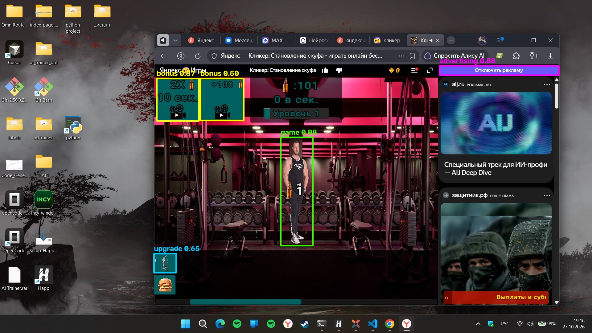

# Clicker AI — бот для игры «Кликер: Становление шкафа»

Практическая работа по теме **«ИИ от сбора до внедрения»**: полный цикл — сбор
скриншотов, разметка, аугментация, обучение YOLOv8, авторазметка и работающий бот,
который играет в игру на Яндекс Играх.




## Что умеет бот

| Класс модели | Что это на экране | Что делает `app.py` |
|---|---|---|
| `game` | персонаж-шкаф в центре сцены | кликает по центру рамки — основной клик |
| `upgrade` | кнопки улучшений в левом нижнем углу | покупает улучшения, перебирая найденные кнопки |
| `bonus` | кнопки «2X», «+100» в левой части экрана | нажимает бонусы по таймеру |
| `advertising` | фиолетовая кнопка «Отключить рекламу» | по флагу `--close-ads` нажимает её |

Бот:
* захватывает экран или только окно игры;
* ищет объекты моделью YOLOv8n и рисует рамки в режиме `--preview`;
* кликает только когда окно игры активно (проверка по заголовку);
* имеет аварийную остановку: мышь в левом верхнем углу, `F8` — пауза,
  `F9`/`Esc` — выход, `Ctrl+C` в консоли;
* умеет работать вхолостую: `--dry-run` показывает детекцию без кликов.

## Классы и датасет

* 84 скриншота 1920×1080 из игры;
* 31 скриншот размечен вручную в **X-AnyLabeling** (рамка персонажа, класс `game`);
* остальные 53 размечены автоматически предварительной моделью и проверены визуально
  (`game_boxes.json`, скрипт `auto_label.py`);
* рамки интерфейса сгенерированы цветовой сегментацией OpenCV:
  бирюзовые кнопки → `bonus` / `upgrade`, фиолетовая кнопка → `advertising`
  (`build_dataset.py`);
* итог: **84 изображения, 68 train / 16 val**, объектов: `game` — 84,
  `upgrade` — 46, `advertising` — 40, `bonus` — 113;
* формат — YOLO HBB (`dataset_final/images`, `dataset_final/labels`, `data_final.yaml`).


## Результаты обучения

Модель: **YOLOv8n**, 60 эпох, `imgsz=640`, `batch=16`, CPU, seed 0.
Итоговые веса: `best.pt` (4 класса), ONNX-копия: `best.onnx`.

| Метрика | Значение |
|---|---:|
| mAP@50 | **0.989** |
| mAP@50-95 | **0.907** |
| Precision | **0.997** |
| Recall | **0.962** |

По классам (отложенная выборка, 16 кадров, 56 объектов):

| Класс | Precision | Recall | mAP@50 | mAP@50-95 |
|---|---:|---:|---:|---:|
| `game` | 0.994 | 1.000 | 0.995 | 0.751 |
| `upgrade` | 1.000 | 0.889 | 0.972 | 0.932 |
| `advertising` | 0.996 | 1.000 | 0.995 | 0.950 |
| `bonus` | 1.000 | 0.960 | 0.995 | 0.995 |

Практическая проверка `check_detections.py` (conf = 0.35): персонаж найден на
**16/16** кадрах, средний IoU = **0.856**, все рамки прошли фильтр `app.py`;
FP: 1 у `upgrade`, FN: 1 у `upgrade`, остальные классы без ошибок.

Сквозной тест `app.py` на окне с эталонным кадром: 87 обработанных кадров за
8 секунд (≈10.5 FPS), стабильно найдены `game: 1`, `upgrade: 2`,
`advertising: 1`, `bonus: 2`. Режим `--preview` работает и при сборке OpenCV
без GUI: автоматически используется окно Tkinter.


Графики обучения, матрица ошибок и примеры предсказаний: `docs/training/`.
Исходные метрики в машинном виде: `docs/metrics.json`.

## Быстрый старт

```powershell
# 1. Виртуальное окружение
python -m venv .venv
.\.venv\Scripts\activate

# 2. Зависимости (CPU-версия PyTorch для Windows)
pip install torch torchvision --index-url https://download.pytorch.org/whl/cpu
pip install -r requirements.txt

# 3. Проверить, что модель видит объекты на скриншотах
python validate.py --model best.pt --source screenshots --limit 8

# 4. Запустить бота (окно игры должно быть активно)
python app.py --model best.pt --preview

# 5. Запуск только с кликами по персонажу и улучшениям
python app.py --model best.pt --no-bonuses --upgrade-interval 2
```

Полезные команды:

```powershell
python app.py --list-windows                  # список окон и их координат
python app.py --model best.pt --dry-run --preview --max-seconds 15
python app.py --model best.pt --crop-window   # захватывать только окно игры
python app.py --model best.pt --close-ads     # нажимать «Отключить рекламу»
```

Если игра открыта в браузере, её заголовок обычно содержит слово «Кликер».
Если нет — укажите свою часть заголовка: `--window "Яндекс Игры"`.

## Полный цикл воспроизведения

```text
screener.py        → screenshots/*.png          (автосбор скриншотов окна игры)
X-AnyLabeling      → screenshots/*.json         (ручная разметка 31 кадра)
train_v2.py        → runs/detect/game_v1        (предварительная модель, 1 класс)
auto_label.py      → auto_labels/*.json|*.txt   (авторазметка новых кадров)
build_dataset.py   → dataset_final + data_final.yaml
augment.py         → dataset_aug + data_aug.yaml (офлайн-аугментация с рамками)
train_final.py     → runs/detect/clicker_final  (итоговая модель, 4 класса)
validate.py        → метрики и примеры детекции
ptToOnnx.py        → best.onnx                  (для X-AnyLabeling)
app.py             → бот
```

Команды обучения:

```powershell
python prepare_dataset.py     # JSON X-AnyLabeling → YOLO, dataset_v2
python train_v2.py            # предварительная модель (1 класс game)
python auto_label.py --model runs/detect/game_v1/weights/best.pt
python build_dataset.py       # итоговый датасет на 4 класса
python train_final.py         # итоговая модель
python ptToOnnx.py            # экспорт best.pt → best.onnx
```

## Структура проекта

```text
Clicker_AI/
├── app.py                  # бот: детекция, клики, улучшения, бонусы, реклама
├── screener.py             # автоматический сбор скриншотов окна игры
├── auto_label.py           # авторазметка моделью → JSON X-AnyLabeling + YOLO txt
├── prepare_dataset.py      # ручные JSON → YOLO, датасет для первой модели
├── build_dataset.py        # сборка итогового датасета на 4 класса
├── augment.py              # аугментация с пересчётом рамок
├── train.py                # базовый пример обучения из задания
├── train_v2.py             # обучение предварительной модели (game)
├── train_final.py          # обучение итоговой модели (4 класса)
├── validate.py             # метрики и визуальная проверка
├── check_detections.py     # практическая проверка TP/FP/FN и фильтра app.py
├── ptToOnnx.py             # экспорт в ONNX
├── classes.txt             # имена классов для экспорта YOLO
├── data_final.yaml         # конфиг датасета (nc=4)
├── my_cookie_model.yaml    # конфиг кастомной модели для X-AnyLabeling
├── requirements.txt
├── best.pt                 # итоговая модель YOLOv8n (4 класса)
├── best.onnx               # она же в ONNX
├── bestV1.pt               # исходная модель пользователя (не используется)
├── dataset_final/          # размеченный датасет (images + labels)
├── screenshots/            # исходные скриншоты и JSON-разметка (локально)
└── docs/
    ├── examples/           # примеры детекции
    └── training/           # графики, матрица ошибок, кривые
```

## Как это работает

1. **Сбор.** `screener.py` находит окно по части заголовка, снимает только его и
   пропускает почти одинаковые кадры (сравнение уменьшенных копий по средней
   разнице яркости).
2. **Разметка.** Первые 31 кадр размечены вручную. По ним обучена односклассовая
   модель `game_v1` (mAP@50 = 0.995 на 6 val-кадрах). Ею автоматически размечены
   остальные 53 кадра, результат проверен глазами.
3. **UI-объекты.** Кнопки улучшений, бонусов и рекламы имеют стабильные цвета,
   поэтому их рамки генерируются OpenCV по HSV-маске. Это быстрее и точнее ручной
   разметки 84 кадров.
4. **Обучение.** Итоговая модель — YOLOv8n с 4 классами. Встроенные аугментации
   Ultralytics (mosaic, HSV, масштаб, сдвиг) + опционально `augment.py`.
5. **Инференс.** `app.py` делает скриншот, запускает модель, сортирует детекции по
   уверенности, выбирает лучшую рамку персонажа и кликает по её центру. Для
   улучшений и бонусов работают отдельные таймеры.
6. **Авторазметка.** `best.onnx` + `my_cookie_model.yaml` загружаются в
   X-AnyLabeling: кнопки `D`/`I` автоматически ставят рамки на новых скриншотах.

## Ответы на вопросы задания

**Можно ли использовать авторазметку для проверки работоспособности модели до
написания кода?**

Да. Это быстрый smoke-тест: загружаем ONNX в X-AnyLabeling, прогоняем 5–10 новых
кадров и смотрим, попадает ли модель в персонажа и кнопки. Но это **не замена
валидации**: авторазметка использует ту же модель, поэтому её ошибки не видны
как ошибки — модель просто переносит их в JSON. Для количественной оценки нужна
отложенная выборка с ручной разметкой и метрики (`validate.py --data
data_final.yaml`: mAP, precision, recall). Авторазметка отвечает на вопрос
«модель вообще видит объект?», а валидация — «насколько точно и стабильно?».

## Ограничения

* Модель обучена на скриншотах 1920×1080 с одним масштабом интерфейса; при
  сильном зуме браузера или другой теме оформления качество может снизиться.
* Класс `advertising` — это фиолетовая кнопка «Отключить рекламу». Крестик
  закрытия всплывающего рекламного окна в датасете не размечен.
* Датасет небольшой (84 кадра), часть кадров — почти одинаковые соседние моменты,
  поэтому метрики на val выглядят оптимистично.
* Бот кликает по экранным координатам: не запускайте его, если окно игры
  перекрыто другим окном. Защита — проверка активного заголовка и `--dry-run`.
* `--close-ads` может открыть страницу оплаты Яндекс Плюса — используйте
  осознанно.

## Публикация на GitHub

```powershell
git add .
git commit -m "Clicker AI: YOLOv8-бот, датасет и отчёт"
git branch -M main
git remote add origin https://github.com/<ваш-логин>/clicker-ai.git
git push -u origin main
```

Или через GitHub CLI:

```powershell
gh repo create clicker-ai --public --source=. --remote=origin --push
```

Ссылку на репозиторий нужно отправить на **polivanov_ed@itmoscow.pro**.

## Автор

Работа выполнена в рамках практического задания «Полный цикл ИИ».
Игра: «Кликер: Становление шкафа» (Яндекс Игры).
