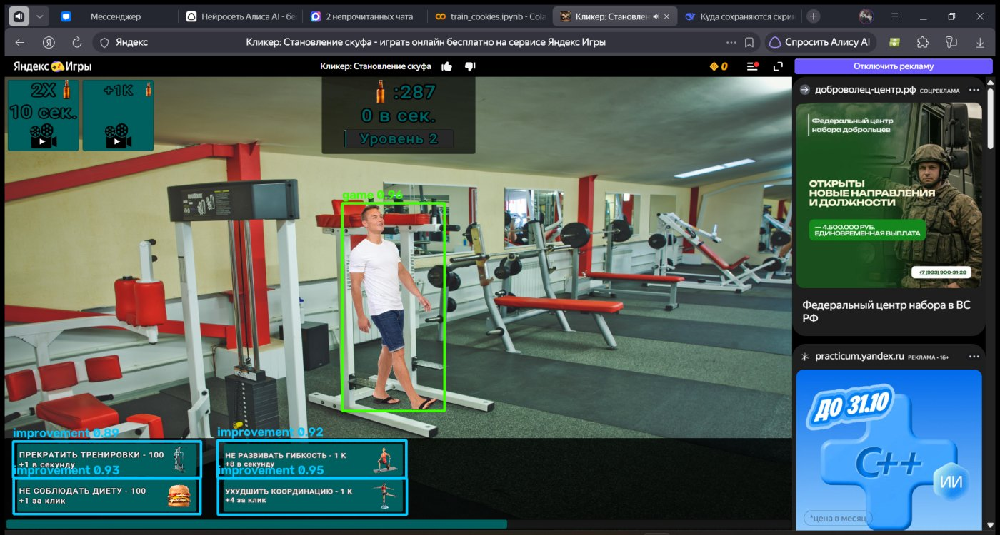
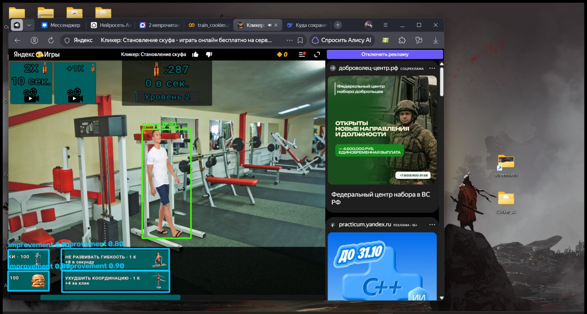
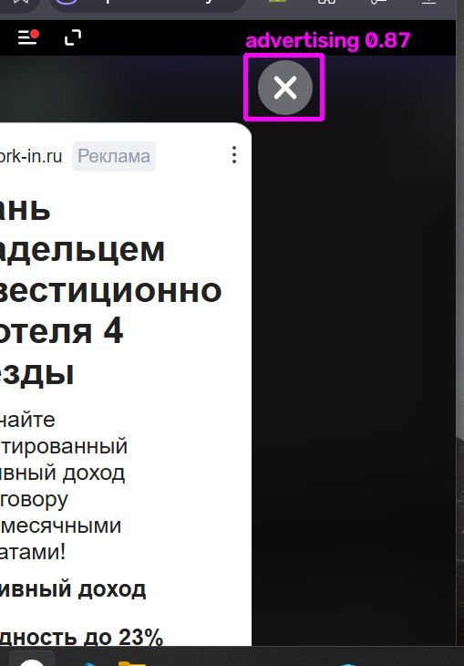
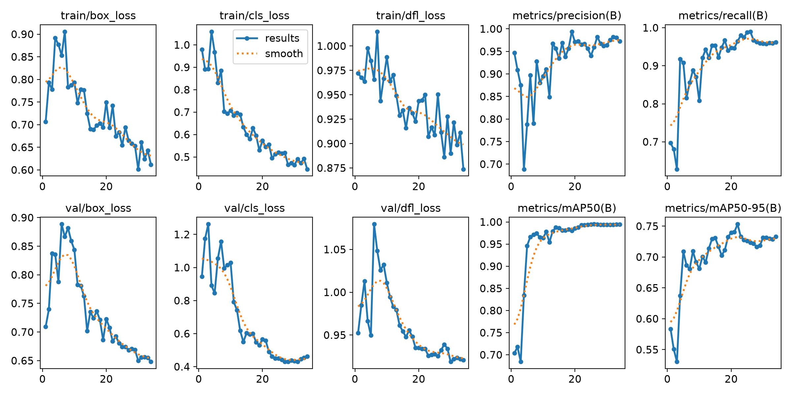
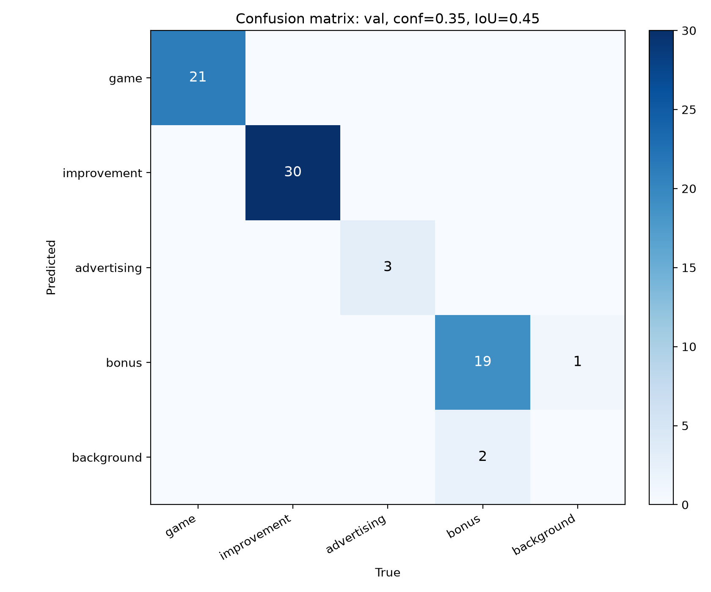

# Clicker AI — бот для игры «Кликер: Становление шкафа»

Практическая работа по теме **«ИИ от сбора до внедрения»**: полный цикл — сбор
скриншотов, ручная и автоматическая разметка, обучение YOLOv8, авторазметка новых
кадров и работающий бот, который играет в игру на Яндекс Играх.

**Репозиторий:** https://github.com/egormorozov708-hub/clicker-ai








## Что умеет бот

| Класс модели | Что это на экране | Что делает `app.py` |
|---|---|---|
| `game` | персонаж текущего уровня (на 1-м и 2-м уровне — разные персонажи) | кликает по центру лучшей рамки — основной клик по печеньке/персонажу |
| `improvement` | кнопки покупки улучшений в левом нижнем углу | раз в 30 секунд покупает **одну** кнопку, следующую по очереди, затем возвращается к `game` |
| `advertising` | крестик `X` закрытия рекламного окна справа сверху | автоматически закрывает рекламу тем же кликом, что и по `game` |
| `bonus` | кнопки «2X», «+1K» в левой верхней части | нажимает бонусы по таймеру |

Бот:

* захватывает экран или только окно игры;
* запускает **ONNX-модель через ONNX Runtime** (Ultralytics нужен только для
  обучения и подготовки данных, в рабочем боте не используется);
* рисует рамки в режиме `--preview`;
* кликает только когда окно игры активно (проверка по заголовку); если окно не
  найдено, клики отключаются, пока не указан `--allow-any-window`;
* закрывает рекламу автоматически (отключается флагом `--no-close-ads`);
* покупает улучшения по очереди раз в 30 секунд (`--upgrade-interval`);
* нажимает бонусы раз в 12 секунд (`--bonus-interval`);
* останавливается на **Пробел**, ставится на паузу по `F8`, выходит по `F9`/`Esc`;
* имеет защиту `pyautogui` (мышь в левом верхнем углу) и `Ctrl+C`;
* умеет работать вхолостую: `--dry-run` показывает детекцию без кликов.

## Классы и датасет

Датасет собран из трёх источников и покрывает два уровня игры. В репозиторий он
**не входит** (это требование к чистому GitHub); локально он собирается скриптом
`build_dataset.py`.

| Источник | Кадров | Что размечено |
|---|---:|---|
| `screenshots/` (уровень 1) | 84 | `game` — вручную и авторазметкой, кнопки UI — цветовой сегментацией |
| `level 2/` (уровень 2) | 30 | `game` и `improvement` — вручную в X-AnyLabeling |
| `advertising/` (реклама) | 19 | `advertising` — крестик закрытия, вручную |

* итог: **133 изображения, 108 train / 25 val**, объектов: `game` — 111,
  `improvement` — 132, `advertising` — 19, `bonus` — 113;
* персонаж на втором уровне другой, поэтому класс `game` дообучен на обоих
  уровнях; при добавлении нового уровня достаточно разметить 20–30 кадров и
  повторить fine-tune;
* три ошибочные рамки, где вместо персонажа был обведён текст «Уровень 2»,
  отброшены при сборке датасета;
* формат — YOLO HBB (`dataset_final/images`, `dataset_final/labels`,
  `data_final.yaml`).


## Результаты обучения

Модель: **YOLOv8n**, дообучение предыдущей версии на объединённом датасете:
40 эпох, `imgsz=640`, `batch=16`, CPU, `patience=12`, `lr0=0.002`, косинусное
расписание, `warmup_epochs=3`, `close_mosaic=10`, seed 0.

В репозитории хранится **один лучший прогон**:

* `runs/detect/clicker_levels/weights/best.pt` — итоговые веса YOLOv8n (4 класса);
* `runs/detect/clicker_levels/results.png`, `results.csv`, кривые, матрица ошибок
  и примеры предсказаний — артефакты этого же прогона;
* `best.onnx` — та же модель в ONNX, именно её использует `app.py`.

| Метрика | Значение |
|---|---:|
| mAP@50 | **0.9929** |
| mAP@50-95 | **0.7532** |
| Precision | **0.9537** |
| Recall | **0.9799** |

По классам (отложенная выборка, 25 кадров, 75 объектов):

| Класс | Precision | Recall | mAP@50 | mAP@50-95 |
|---|---:|---:|---:|---:|
| `game` | 0.972 | 1.000 | 0.995 | 0.700 |
| `improvement` | 0.982 | 1.000 | 0.995 | 0.795 |
| `advertising` | 0.911 | 1.000 | 0.995 | 0.531 |
| `bonus` | 0.951 | 0.919 | 0.987 | 0.987 |

Практическая проверка `check_detections.py` (conf = 0.35): персонаж найден на
21/21 кадрах, средний IoU = 0.843, фильтр `app.py` прошли 21 рамка `game` и
3 из 3 рамок `advertising`. FP: bonus=1; FN: bonus=2.

**Сквозной тест `app.py` на ONNX Runtime в режиме `--dry-run`** (синтетическое
полноэкранное окно `ClickerTest`, клики только логировались):

- второй уровень, `--upgrade-interval 3 --no-bonuses`, 8 с: бот стабильно
  находил `game` и 4 кнопки `improvement`, раз в 3 с покупал ровно одно
  улучшение по очереди («1/4», «2/4»), итого 40 действий;
- рекламный попап поверх игры, 7 с: крестик `advertising` найден с
  уверенностью 0.95, пока реклама видна, кликов по `game` не было; закрытие
  повторялось с кулдауном 3 с, итого 3 действия только по рекламе;
- остановка по **Пробелу** проверена отдельно (с превью и без): процесс
  завершается, в консоли печатается итоговая статистика.

Подробный лог: `docs/app_test.txt`.





Графики обучения, матрица ошибок и примеры предсказаний:
`runs/detect/clicker_levels/`. Исходные метрики в машинном виде:
`docs/metrics.json`, `docs/check.json`.

## Быстрый старт

```powershell
# 1. Виртуальное окружение
python -m venv .venv
.\.venv\Scripts\activate

# 2. Зависимости (CPU-версия PyTorch для Windows)
pip install torch torchvision --index-url https://download.pytorch.org/whl/cpu
pip install -r requirements.txt

# 3. Запустить бота (окно игры должно быть активно)
python app.py

# 4. Проверка логики без кликов: улучшение каждые 3 секунды
python app.py --dry-run --upgrade-interval 3 --max-seconds 20
```

`app.py --help` показывает все параметры. По умолчанию:

| Параметр | Значение |
|---|---:|
| модель | `best.onnx` |
| уверенность `--conf` | 0.45 |
| IoU для NMS `--iou` | 0.45 |
| интервал кликов по `game` | 0.08 с |
| улучшение | раз в 30 с |
| бонус | раз в 12 с |
| кулдаун закрытия рекламы | 3 с |

Полезные команды:

```powershell
python app.py --list-windows                     # список окон и их координат
python app.py --preview --dry-run --max-seconds 15  # превью только для отладки
python app.py --crop-window                      # захватывать только окно игры
python app.py --conf 0.55                        # строже фильтр уверенности
python app.py --no-close-ads                     # не закрывать рекламу
python app.py --no-bonuses                       # только game + improvement
python app.py --no-improvements                  # без покупок улучшений
python app.py --allow-any-window                 # если окно игры не найдено
```

Горячие клавиши: **Пробел** — остановка, `F8` — пауза/продолжить,
`F9`/`Esc` — выход, `Ctrl+C` — выход из консоли.

Превью (`--preview`) предназначено для отладки: окно превью перехватывает
фокус, поэтому для реальных кликов запускайте бота без него (или держите окно
игры активным и не перекрывайте его превью).

Если игра открыта в браузере, её заголовок обычно содержит слово «Кликер».
Если нет — укажите свою часть заголовка: `--window "Яндекс Игры"`.

## Полный цикл воспроизведения

```text
screener.py        → screenshots/*.png              (автосбор скриншотов окна игры)
X-AnyLabeling      → screenshots/*.json             (ручная разметка game)
X-AnyLabeling      → level 2/*.json, advertising/*.json
build_dataset.py   → dataset_final + data_final.yaml (game, improvement, advertising, bonus)
train_final.py     → runs/detect/clicker_levels     (fine-tune итоговой модели)
validate.py        → docs/metrics.json, docs/examples
check_detections.py→ TP/FP/FN и проверка фильтров app.py
ptToOnnx.py        → best.onnx                      (для бота и X-AnyLabeling)
app.py             → бот на ONNX Runtime
```

Команды:

```powershell
python screener.py --window "Кликер" --interval 2 --out screenshots
python build_dataset.py       # соберёт dataset_final из трёх папок с разметкой
python train_final.py --weights path/to/previous_best.pt
python validate.py --data data_final.yaml
python check_detections.py --conf 0.35
python ptToOnnx.py            # runs/.../best.pt → best.onnx
```

Датасет и промежуточные веса в репозиторий не входят: для повторного обучения
подготовьте их локально. Готовые `best.onnx` и
`runs/detect/clicker_levels/weights/best.pt` уже есть в репозитории.

Для авторазметки новых кадров обученной моделью:

```powershell
python auto_label.py --model best.onnx --source new_frames --out auto_labels
```

Результат можно открыть в X-AnyLabeling, проверить и поправить. Для работы
авторазметки прямо в X-AnyLabeling используются `best.onnx` и
`my_cookie_model.yaml`.

## Структура проекта

```text
Clicker_AI/
├── app.py                  # бот на ONNX Runtime: детекция, клики, улучшения, бонусы, реклама
├── screener.py             # автоматический сбор скриншотов окна игры
├── auto_label.py           # авторазметка моделью → JSON X-AnyLabeling + YOLO txt
├── build_dataset.py        # сборка датасета из трёх источников разметки
├── train_final.py          # дообучение итоговой модели (4 класса)
├── validate.py             # метрики и визуальная проверка
├── check_detections.py     # практическая проверка TP/FP/FN и фильтров app.py
├── ptToOnnx.py             # экспорт в ONNX
├── classes.txt             # имена классов для экспорта YOLO
├── data_final.yaml         # конфиг датасета (nc=4)
├── my_cookie_model.yaml    # конфиг кастомной модели для X-AnyLabeling
├── requirements.txt
├── best.onnx               # итоговая модель для app.py (ONNX Runtime)
├── runs/
│   └── detect/
│       └── clicker_levels/ # единственный сохранённый прогон обучения
│           ├── weights/best.pt
│           ├── results.png / results.csv
│           ├── confusion_matrix*.png
│           └── val_batch0_*.jpg
└── docs/
    ├── examples/           # три примера детекции
    ├── app_test.txt        # лог сквозных тестов
    ├── metrics.json        # метрики обучения
    ├── check.json          # TP/FP/FN
    └── pipeline.png
```

Локально (не в Git): `dataset_final/`, `screenshots/`, `level 2/`,
`advertising/`, `best.pt`, `bestV1.pt` — исходные данные и промежуточные модели.

## Как это работает

1. **Сбор.** `screener.py` находит окно по части заголовка, снимает только его и
   пропускает почти одинаковые кадры (сравнение уменьшенных копий по средней
   разнице яркости).
2. **Разметка.** Первый уровень: 31 кадр размечен вручную, остальные — моделью
   `game_v1` с визуальной проверкой. Второй уровень: 30 кадров, вручную
   `game` + `improvement`. Реклама: 19 кадров, вручную крестик `advertising`.
3. **UI-объекты первого уровня.** Кнопки улучшений и бонусов имеют стабильные
   цвета, поэтому их рамки для старых 84 кадров генерируются OpenCV по HSV-маске.
4. **Обучение.** Итоговая модель — YOLOv8n с 4 классами, дообученная от
   предыдущей версии на объединённом датасете. Встроенные аугментации
   Ultralytics: mosaic, HSV, масштаб, сдвиг.
5. **Инференс.** `app.py` делает скриншот, выполняет letterbox 640×640,
   запускает ONNX Runtime, применяет class-aware NMS и геометрические фильтры.
   Клик по `game`, закрытие рекламы, покупка улучшения и нажатие бонуса
   используют один низкоуровневый примитив `click_box()`, поэтому логика не
   дублируется.
6. **Планировщик улучшений.** Раз в 30 секунд бот покупает одну кнопку
   `improvement`, циклически переходя к следующей, и сразу возвращается к кликам
   по `game`. Если кнопок не видно, попытка повторяется через секунду.
7. **Авторазметка.** `best.onnx` + `my_cookie_model.yaml` загружаются в
   X-AnyLabeling: кнопки `D`/`I` автоматически ставят рамки на новых скриншотах.

## Ответы на вопросы задания

**Можно ли использовать авторазметку для проверки работоспособности модели до
написания кода?**

Да. Это быстрый smoke-тест: загружаем ONNX в X-AnyLabeling, прогоняем 5–10 новых
кадров и смотрим, попадает ли модель в персонажа и кнопки. Но это **не замена
валидации**: авторазметка использует ту же модель, поэтому её ошибки не видны
как ошибки — модель просто переносит их в JSON. Для количественной оценки нужна
отложенная выборка с ручной разметкой и метрики (`validate.py --data
data_final.yaml`: mAP, precision, recall). Авторазметка отвечает на вопрос
«модель вообще видит объект?», а валидация — «насколько точно и стабильно?».

## Ограничения

* Размечены два уровня игры. На третьем уровне персонаж снова изменится —
  модель нужно дообучить на 20–30 новых кадрах.
* Модель обучена на скриншотах 1920×1080 и 1938×1038 с одним масштабом
  интерфейса; при сильном зуме браузера или другой теме оформления качество
  может снизиться.
* Класс `advertising` — крестик конкретного рекламного окна. Для других попапов
  (видео, баннеры) нужно добавить кадры и, возможно, отдельный класс.
* Датасет небольшой (133 кадра), часть кадров — почти одинаковые соседние
  моменты, поэтому метрики на val выглядят оптимистично.
* Бот кликает по экранным координатам: не запускайте его, если окно игры
  перекрыто другим окном. Защита — проверка активного заголовка и `--dry-run`.
* Автоматическое закрытие рекламы может случайно нажать на элемент интерфейса,
  если модель ошибётся; для отладки есть `--dry-run` и `--no-close-ads`.
* Скорость на CPU — около 6–9 FPS для кадра 1920×1080; для более высокой
  частоты можно уменьшить окно захвата (`--crop-window`) или размер входа модели.

## Публикация на GitHub

Репозиторий проекта: **https://github.com/egormorozov708-hub/clicker-ai**

В репозитории нет датасета, виртуальных окружений и старых весов — только код,
`best.onnx`, один лучший прогон в `runs/detect/clicker_levels/` и отчёт.

Клонирование и запуск:

```powershell
git clone https://github.com/egormorozov708-hub/clicker-ai.git
cd clicker-ai
python -m venv .venv
.\.venv\Scripts\activate
pip install -r requirements.txt
python app.py --preview
```

Обновление репозитория после изменений:

```powershell
git add .
git commit -m "Описание изменений"
git push
```

Ссылка для отправки преподавателю: **polivanov_ed@itmoscow.pro**.

## Автор

Работа выполнена в рамках практического задания «Полный цикл ИИ».
Игра: «Кликер: Становление шкафа» (Яндекс Игры).
