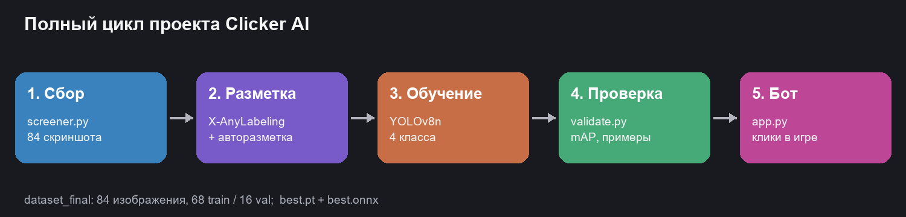
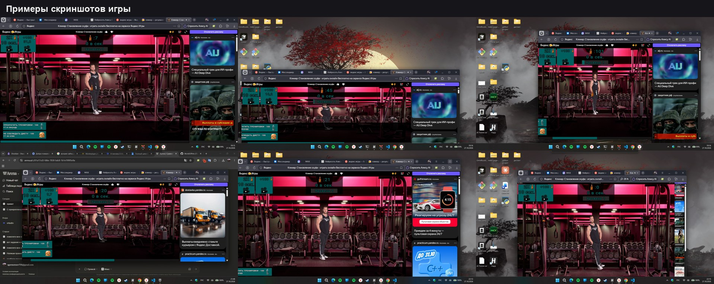
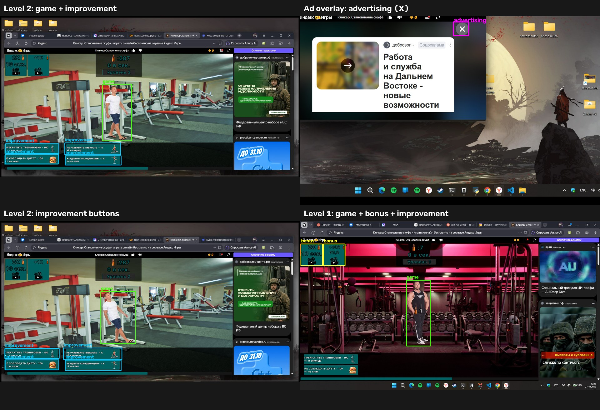
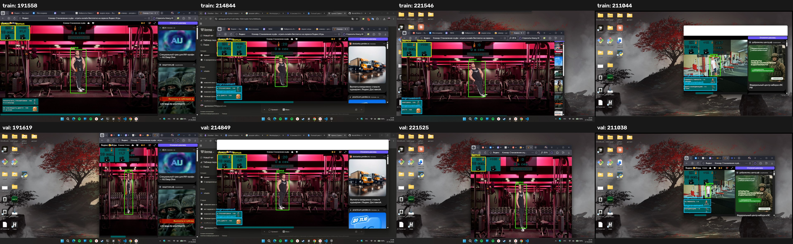

# Отчёт по практической работе «ИИ от сбора до внедрения»

**Тема:** полный цикл разработки ИИ-решения для онлайн-игры-кликера.
**Игра:** «Кликер: Становление шкафа» (Яндекс Игры).
**Дата:** 29.10.2026.
**Итоговый проект:** `Clicker_AI`; модель `best.onnx` (YOLOv8n, 4 класса),
исходные веса — `runs/detect/clicker_levels/weights/best.pt`.



---

## 1. Цель и задачи

Цель — пройти полный цикл: собрать данные, разметить их, обучить модель
детекции, встроить её в программу и автоматизировать игровой процесс.

Задачи:

1. Собрать скриншоты игры (фактически собрано 133 кадра трёх типов).
2. Разметить целевые объекты в X-AnyLabeling и экспортировать в YOLO HBB.
3. Обучить модель YOLOv8, поддерживающую два игровых уровня.
4. Написать `app.py`, который в реальном времени находит объекты и кликает.
5. Модернизировать проект: автоматически закрывать рекламу, покупать улучшения
   по очереди раз в 30 секунд и нажимать бонусы.
6. Перевести рабочего бота на ONNX Runtime, добавить остановку на Пробел,
   кулдауны и настройку уверенности.
7. Убрать из проекта промежуточные файлы и датасет, оставить один лучший
   результат обучения в `runs/`, проверить работоспособность.
8. Опубликовать проект на GitHub и подготовить демонстрацию.

---

## 2. Сбор данных

Для сбора используется `screener.py`. Скрипт:

* ищет окно браузера по части заголовка (`--window "Кликер"`);
* снимает только область окна, а не весь экран;
* сравнивает уменьшенные копии соседних кадров и пропускает почти одинаковые
  (порог `--diff`);
* сохраняет PNG в указанную папку с именем по дате и времени.

Собраны три набора:

| Папка | Кадров | Разрешение | Содержимое |
|---|---:|---|---|
| `screenshots/` | 84 | 1920×1080 | первый уровень, разные положения персонажа и состояния кнопок |
| `level 2/` | 30 | 1938×1038 | второй уровень: другой персонаж, кнопки улучшений |
| `advertising/` | 19 | 1409×887 | всплывающее рекламное окно с крестиком закрытия |



Исходные папки и собранный датасет в репозиторий не входят: это локальные
данные, которые могут весить сотни мегабайт. В Git остаются только скрипты
сбора и примеры разметки.

---

## 3. Разметка данных

### 3.1. Первый уровень

В X-AnyLabeling открыта папка `screenshots/`, инструментом Rectangle (`R`)
обведён персонаж, класс — `game`. Разметка экспортирована в формат **YOLO HBB**,
рядом с каждым PNG лежит одноимённый JSON. Вручную размечен **31 кадр**.

По этим кадрам обучена предварительная односклассовая модель `game_v1`
(YOLOv8n, 60 эпох, ранняя остановка на 48-й эпохе). На 6 val-кадрах она
показала **mAP@50 = 0.995**, **mAP@50-95 = 0.760**. Этой моделью автоматически
размечены оставшиеся **53 кадра**; результат проверен визуально, ошибочные рамки
(например, на рекламном персонаже справа) отсеяны эвристикой по положению центра.

Кнопки интерфейса первого уровня имеют стабильные цвета, поэтому для них
написана автоматическая разметка на OpenCV (`build_dataset.py`):

* бирюзовые кнопки в левой верхней части → `bonus`;
* бирюзовые кнопки в левой нижней части → `improvement`.

### 3.2. Второй уровень

На втором уровне меняется персонаж, поэтому старые рамки `game` к нему не
подходят. Вручную размечены **30 кадров**: персонаж (`game`) и кнопки покупки
улучшений (`improvement`) — всего 27 рамок `game` и 86 рамок `improvement`.

При проверке разметки обнаружены три ошибочные рамки, где вместо персонажа был
обведён текст «Уровень 2» (размеры 93×41, 71×39 и 80×39 пикселей). Они
отброшены при сборке датасета: реальный персонаж всегда выше 100 пикселей и
имеет вытянутую форму.

### 3.3. Реклама

Размечены **19 кадров** с всплывающим рекламным окном. Класс `advertising` —
это маленький крестик `X` в правой верхней части окна (примерно 56–103 px по
ширине и 47–91 px по высоте). Именно по нему нужно кликать, чтобы закрыть
рекламу.

В предыдущей версии проекта класс `advertising` означал фиолетовую кнопку
«Отключить рекламу» и не закрывал всплывающее окно. Теперь семантика класса
изменена: старые фиолетовые рамки из датасета удалены, класс обучается только
на крестике.

### 3.4. Итоговый датасет

| Класс | id | Всего | Train | Val | Что означает |
|---|---:|---:|---:|---:|---|
| `game` | 0 | 111 | 90 | 21 | персонаж текущего уровня — цель основного клика |
| `improvement` | 1 | 132 | 102 | 30 | кнопки покупки улучшений |
| `advertising` | 2 | 19 | 16 | 3 | крестик закрытия рекламного окна |
| `bonus` | 3 | 113 | 92 | 21 | бонусные кнопки 2X / +1K |

Всего **133 изображения**, разбиение **108 train / 25 val** (примерно 80/20).
Каждый пятый кадр каждого источника попадает в val, поэтому все классы
присутствуют в обеих частях. Конфиг — `data_final.yaml` (`nc: 4`). Структура
каталогов соответствует требованию задания: `images/train` ↔ `labels/train`,
`images/val` ↔ `labels/val`.





---

## 4. Обучение модели

### 4.1. Параметры

Модель не обучалась с нуля: выполнено дообучение (fine-tune) предыдущей версии
`best.pt` на объединённом датасете. Это сохраняет уже выученные признаки
интерфейса и требует меньше эпох.

| Параметр | Значение |
|---|---|
| Архитектура | YOLOv8n (Ultralytics) |
| Стартовые веса | предыдущая версия `best.pt` (4 класса) |
| Эпох | 40 |
| Размер входа | 640×640 |
| Batch | 16 |
| Устройство | CPU |
| Seed | 0 |
| patience | 12 |
| lr0 / lrf | 0.002 / 0.01, косинусное расписание |
| warmup_epochs | 3 |
| close_mosaic | 10 |
| Датасет | `data_final.yaml`, 108 train / 25 val |

Запуск: `python train_final.py --weights best.pt`. Результаты:
`runs/detect/clicker_levels/`. В репозитории оставлен только этот лучший прогон:
`weights/best.pt`, `results.png`, `results.csv`, кривые, матрица ошибок и
примеры предсказаний. Из него же получен `best.onnx` командой
`python ptToOnnx.py`.

### 4.2. Метрики на отложенной выборке

| Метрика | Значение |
|---|---:|
| mAP@50 | **0.9929** |
| mAP@50-95 | **0.7532** |
| Precision | **0.9537** |
| Recall | **0.9799** |

| Класс | Precision | Recall | mAP@50 | mAP@50-95 |
|---|---:|---:|---:|---:|
| `game` | 0.972 | 1.000 | 0.995 | 0.700 |
| `improvement` | 0.982 | 1.000 | 0.995 | 0.795 |
| `advertising` | 0.911 | 1.000 | 0.995 | 0.531 |
| `bonus` | 0.951 | 0.919 | 0.987 | 0.987 |

Практическая проверка `check_detections.py` (conf = 0.35): персонаж найден на
21/21 кадрах, средний IoU = 0.843, фильтр `app.py` прошли 21 рамка `game` и
3 из 3 рамок `advertising`. FP: bonus=1; FN: bonus=2.

**Сквозной тест `app.py` на ONNX Runtime в режиме `--dry-run`** (синтетическое
полноэкранное окно `ClickerTest`, клики только логировались):

- второй уровень, `--upgrade-interval 3 --no-bonuses`, 8 с: бот стабильно
  находил `game` и 4 кнопки `improvement`, раз в 3 с покупал ровно одно
  улучшение по очереди («1/4», «2/4»), итого 40 действий (38 по `game`,
  2 улучшения);
- рекламный попап поверх игры, 7 с: крестик `advertising` найден с
  уверенностью 0.95, пока реклама видна, кликов по `game` не было; закрытие
  повторялось с кулдауном 3 с, итого 3 действия только по рекламе;
- остановка по **Пробелу** проверена отдельно (с превью и без): процесс
  завершается, в консоли печатается итоговая статистика.

Подробный лог: `docs/app_test.txt`.

Метрики получены командой:

```powershell
python validate.py --model runs/detect/clicker_levels/weights/best.pt --data data_final.yaml
```

Графики: `runs/detect/clicker_levels/results.png`,
`confusion_matrix.png`, `BoxPR_curve.png`, примеры предсказаний
`val_batch*_pred.jpg`.

### 4.3. Анализ ошибок

* Основные ошибки — на кадрах, где персонаж частично перекрыт интерфейсом или
  находится у края сцены.
* `game` на втором уровне — другой персонаж; без дообучения модель его не
  находила. После добавления 30 кадров уровень детектируется.
* Крестик `advertising` маленький и похож на системные кнопки окна, поэтому в
  `app.py` добавлен геометрический фильтр: размер 40–200 px, почти квадратная
  форма, правая часть кадра. По вертикали ограничение мягкое: попап может
  оказаться ниже в зависимости от положения окна браузера.
* Кнопки `improvement` и `bonus` иногда путаются, если меняется цвет/размер
  кнопки после покупки; помогают пространственные фильтры и разные таймеры.
* Часть кадров — почти одинаковые соседние моменты, поэтому val-метрики
  выглядят оптимистично; для честной оценки нужно разделять кадры по времени
  съёмки, а не случайно.

---

## 5. Интеграция: программа `app.py`

### 5.1. Алгоритм

1. Найти окно игры по части заголовка (или работать по всему экрану).
2. Сделать скриншот окна/экрана.
3. Выполнить letterbox до 640×640 и запустить **ONNX Runtime**; получить
   4 класса, применить class-aware NMS и геометрические фильтры.
4. Отсортировать детекции по уверенности.
5. Проверить активное окно: клики выполняются, только если заголовок содержит
   название игры.
6. Приоритет действий в каждом кадре:
   * если виден крестик `advertising` — закрыть рекламу (кулдаун 3 с);
   * иначе, если идёт пауза после покупки/закрытия, пропустить клик;
   * иначе, если наступило время (раз в 30 с) — купить **одно** улучшение,
     следующее по очереди, и вернуться к `game`;
   * иначе — клик по `game` и, по отдельному таймеру, по `bonus`.
7. Повторить цикл; в режиме `--preview` показать окно с рамками.

Рабочий бот **не импортирует Ultralytics**: используется только
`onnxruntime`, `opencv-python`, `numpy`, `pyautogui` и `pygetwindow`.
Ultralytics остаётся зависимостью для обучения (`train_final.py`,
`validate.py`) и подготовки данных.

### 5.2. Закрытие рекламы без дублирования кода

Требование «сделать копию части кода кликанья, а не всего файла» реализовано
через общий низкоуровневый примитив:

```python
def click_box(box, offset, cfg, label):
    x, y = center(box)
    if not cfg.dry_run:
        pyautogui.click(offset[0] + x, offset[1] + y)
    elif label != "game":
        print(f"[dry-run] клик: {label} в ({offset[0] + x}, {offset[1] + y})")
```

`click_game()` и `close_ad()` — отдельные функции с разными фильтрами и
таймерами, но обе вызывают `click_box()`. Логика клика не дублируется.

### 5.3. Покупка улучшений по очереди

Список видимых кнопок `improvement` сортируется по положению (сверху вниз,
слева направо). Каждая кнопка получает стабильный ID — нормализованный центр
рамки; в статистике хранится список уже нажатых в текущем круге ID. Бот выбирает
первую кнопку, которой нет в этом списке. Если UI добавил новую кнопку, она
выбирается следующей; когда все видимые кнопки нажаты, начинается новый круг.
Это устойчиво к пересортировке списка и к дрожанию рамки на несколько пикселей
(допуск 2 % кадра).

После клика ставится пауза `--improvement-settle` (0.4 с), и бот возвращается к
`game`; следующая покупка — через `--upgrade-interval` (по умолчанию 30 с).
Если кнопок не видно, попытка повторяется через `--empty-retry` (1 с), а таймер
не сбрасывается на 30 с. Для бонусов используется та же схема.

### 5.4. Запуск и настройка

```powershell
python app.py
python app.py --dry-run --preview --max-seconds 15
python app.py --crop-window --window "Кликер"
python app.py --conf 0.55 --iou 0.45
python app.py --upgrade-interval 5
python app.py --no-close-ads
```

Превью (`--preview`) — только для отладки: оно перехватывает фокус, поэтому для
реальных кликов запускайте бота без него.

Параметры: `--conf` (0.45), `--iou` (0.45), `--max-det` (100), `--threads`
(0 — авто), `--click-interval` (0.01 с), `--click-burst` (3 клика за кадр),
`--upgrade-interval` (30 с), `--bonus-interval` (12 с), `--ad-cooldown` (3 с),
`--ad-settle` (1 с), `--improvement-settle` (0.4 с), `--empty-retry` (1 с),
`--window-refresh` (1 с). Отключение действий: `--no-game`, `--no-improvements`,
`--no-bonuses`, `--no-close-ads`. Диагностика: `--verbose` показывает причины
отбраковки рамок. Значения проверяются при старте: `--conf`/`--iou` должны
быть в диапазоне 0..1, отрицательные интервалы запрещены, `--click-burst`
должен быть не меньше 1.

За один кадр бот делает `--click-burst` кликов с паузой `--click-interval`.
Это компенсирует низкий FPS детекции: при 9–10 FPS и трёх кликах за кадр
получается примерно 27–30 кликов в секунду (с включённым превью меньше).
Для прежнего темпа достаточно `--click-burst 1`.

Клик по умолчанию выполняется через `pyautogui` (около 3.3 мс на тестовой
машине). Флаг `--native-click` включает WinAPI-клик; на тесте он оказался
медленнее (4.8 мс), поэтому оставлен выключенным.

### 5.5. Безопасность и остановка

* **Пробел** — мгновенная остановка бота (глобальный хоткей через `pynput`;
  в окне превью Пробел также закрывает окно).
* `F8` — пауза/продолжить, `F9`/`Esc` — выход, `Ctrl+C` — выход из консоли.
* `pyautogui.FAILSAFE`: мышь в левом верхнем углу останавливает бота.
* Проверка активного окна: клики выполняются, только если заголовок содержит
  название игры (защита от кликов в чужие окна). Если окно не найдено, клики
  отключаются; для работы по всему экрану нужен явный флаг `--allow-any-window`.
* `--dry-run` — прогон без кликов, все действия пишутся в лог.
* `--max-seconds` — ограничение времени.
* DPI-awareness на Windows, чтобы координаты скриншота и мыши совпадали при
  масштабировании 125/150 %.
* Закрытие окна OpenCV-превью останавливает бота: проверяется
  `cv2.getWindowProperty(...WND_PROP_VISIBLE)`.
* `mss` используется как быстрый захват; при ошибке бот автоматически
  переходит на `pyautogui.screenshot`.

### 5.6. Исправления после код-ревью

| Замечание | Что сделано |
|---|---|
| Плавающие индексы улучшений/бонусов | стабильный ID по нормализованному центру + список нажатых в круге |
| Протухающая геометрия окна | `find_window` перезапрашивается раз в `--window-refresh` (1 с) |
| Закрытие OpenCV-превью не останавливало бота | проверка `getWindowProperty`, возврат `-1` |
| Захардкоженные паузы | `--ad-settle`, `--improvement-settle`, `--empty-retry` |
| Непонятные отбраковки рамок | `--verbose` печатает причину и количество по классам |
| Медленный захват | `mss` + `cv2.cvtColor(BGRA2BGR)`, резерв на `pyautogui` |
| Падение при странном выходе модели | `try/except` вокруг `detect()`, сообщение и остановка |
| Свёрнутые окна в `find_window` | отсеиваются по `isMinimized`, размеру и заголовку |
| `classes.txt` в PyInstaller | поиск рядом с `app.py`, `sys.executable` и в `_MEIPASS` |
| Нативный клик | флаг `--native-click`; на тесте медленнее, по умолчанию выключен |

Пункт про трекинг детекций (IoU-матчинг между кадрами) не внедрялся: для
кликера достаточно стабильной работы на каждом кадре, а трекинг усложнил бы
логику и мог бы кликать по устаревшей позиции.

---

## 6. Модернизация проекта (задачи 5–7)

| Требование | Реализация |
|---|---|
| Автоматизация сбора данных | `screener.py`: захват окна, интервал, пропуск дублей |
| Автоматизация разметки | `auto_label.py` + `best.onnx` + `my_cookie_model.yaml`; режим `D`/`I` в X-AnyLabeling |
| Распознавание «как закрыть рекламу» | класс `advertising` = крестик `X`; автоматическое закрытие, `--no-close-ads` для отключения |
| Покупка улучшений | класс `improvement`; раз в 30 с одно улучшение по очереди, стабильные ID кнопок, возврат к `game` |
| Распознавание и клик по бонусам | класс `bonus`, таймер `--bonus-interval`, стабильные ID |
| Поддержка двух уровней | `game` дообучен на кадрах первого и второго уровня |
| Рабочий бот на ONNX | `app.py` использует `onnxruntime`, ручной letterbox, NMS и постобработку |
| Остановка и настройка | Пробел, `F8`/`F9`/`Esc`, `--conf`, `--iou`, кулдауны, `--dry-run`, `--verbose` |
| Устойчивость и скорость | обновление геометрии окна, `mss`, настраиваемые паузы, диагностика фильтров |
| Чистый GitHub | нет датасета, виртуальных окружений и старых весов; один прогон в `runs/detect/clicker_levels/`, модель `best.onnx` |

---

## 7. Ответ на вопрос задания

> **Вопрос:** а можно ли использовать авторазметку для тестирования
> работоспособности модели перед тем, как писать код?

**Ответ:** да, но как быстрый качественный тест, а не как полноценную валидацию.

* Плюсы: не нужно писать код бота, чтобы увидеть, находит ли модель персонажа и
  кнопки на новых кадрах. X-AnyLabeling показывает рамки и уверенность, сразу
  видны грубые ошибки (рамка на рекламе, пропуск персонажа, лишние объекты).
* Ограничения: авторазметка использует **ту же модель**, поэтому её
  систематические ошибки не обнаруживаются — они просто переносятся в JSON.
  Нет ground truth, нельзя посчитать precision/recall/mAP. Кроме того, человек
  видит только те кадры, которые загрузил, а не всё распределение данных.
* Правильный порядок: авторазметка → визуальная проверка 5–10 кадров → при
  необходимости ручная правка → количественная валидация на отложенной
  выборке (`validate.py --data data_final.yaml`) → только потом код бота.

---

## 8. Ограничения и направления развития

1. **Два уровня.** На третьем уровне персонаж снова изменится; нужно разметить
   20–30 кадров и повторить fine-tune. Архитектура и скрипты к этому готовы.
2. **Мало данных.** 133 кадра — минимум для устойчивой детекции. Нужно 300–500
   кадров с разными темами, разрешениями и масштабами.
3. **Похожие кадры.** Соседние скриншоты почти одинаковы; для честных метрик
   нужен split по игровым сессиям/времени.
4. **Один масштаб интерфейса.** При зуме браузера модель может ошибаться;
   поможет аугментация масштаба и сбор кадров при разном зуме.
5. **Реклама.** Размечен крестик конкретного рекламного окна. Для других попапов
   (видео, баннеры) нужно добавить кадры и, возможно, отдельный класс.
6. **Скорость.** Полный цикл с захватом экрана 1920×1080 даёт около 9–10 FPS
   без превью (с Tk-превью 6–8 FPS из-за отрисовки). Захват `mss` занимает
   ~32–35 мс, инференс ~65 мс. Для ускорения можно включить `--crop-window`,
   уменьшить окно или использовать GPU-провайдер ONNX Runtime.
7. **Хрупкость к обновлениям игры.** При смене оформления модель нужно
   дообучать на новых скриншотах.

---

## 9. Выводы

В ходе работы пройден полный цикл: собраны 133 скриншота трёх типов, размечены
персонажи двух уровней, кнопки улучшений, бонусы и крестик закрытия рекламы,
обучена модель YOLOv8n на 4 класса. Написана программа на ONNX Runtime, которая
в реальном времени находит персонажа, раз в 30 секунд покупает одно улучшение
по очереди, нажимает бонусы и автоматически закрывает рекламу. Добавлены
остановка на Пробел, пауза, кулдауны и настройка порогов уверенности.
Очередь кнопок переведена на стабильные ID, геометрия окна обновляется на лету,
захват ускорен через `mss`, а `--verbose` показывает причины отбраковки рамок.
Дополнительно автоматизированы сбор и разметка данных, подготовлен ONNX-экспорт
для X-AnyLabeling, проект очищен от датасета и промежуточных файлов, проверен и
опубликован на GitHub.

---

## Приложение A. Структура проекта

```text
app.py                  — бот на ONNX Runtime
screener.py             — сбор скриншотов
auto_label.py           — авторазметка
build_dataset.py        — итоговый датасет (4 класса, 3 источника)
train_final.py          — дообучение итоговой модели
validate.py             — метрики и примеры
check_detections.py     — практическая проверка TP/FP/FN
ptToOnnx.py             — экспорт ONNX
classes.txt             — имена классов
data_final.yaml         — конфиг датасета
my_cookie_model.yaml    — конфиг для X-AnyLabeling
best.onnx               — итоговая модель для бота
runs/detect/clicker_levels/ — лучший прогон обучения (best.pt + графики)
docs/                   — примеры детекции, метрики и отчёт
```

Датасет (`dataset_final/`), исходные скриншоты и промежуточные веса в Git не
входят — они остаются локально.

## Приложение B. Команды

```powershell
pip install -r requirements.txt
python build_dataset.py
python train_final.py --weights best.pt
python validate.py --model runs/detect/clicker_levels/weights/best.pt --data data_final.yaml
python check_detections.py --model runs/detect/clicker_levels/weights/best.pt --conf 0.35
python ptToOnnx.py
python app.py
python app.py --dry-run --upgrade-interval 3 --max-seconds 20```

## Приложение C. Ссылка на репозиторий

GitHub: **https://github.com/egormorozov708-hub/clicker-ai**
Почта для отправки: **polivanov_ed@itmoscow.pro**.
